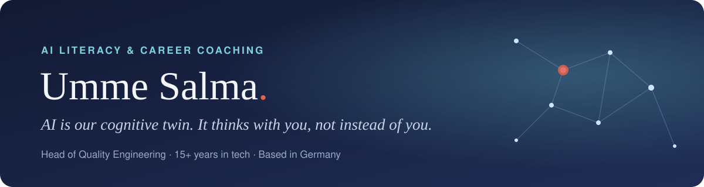
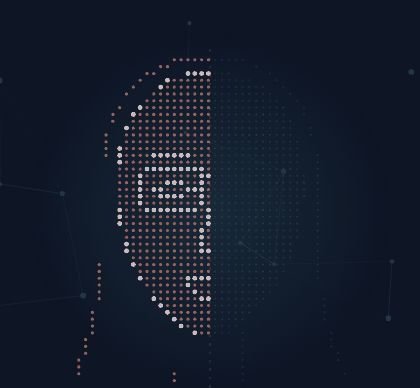

  

<h3 align="center">Yesterday we asked "What is AI?" · Today "What can we do with it?" · Tomorrow "Okay, now what next?"</h3>

  
  
  

---

<table>
<tr>
<td width="58%" valign="top">

## 👋 Hi, I'm Umme Salma

I'm an **AI literacy & career coach** and **Head of Quality Engineering** with **15+ years in tech**.

My path into technology started with artificial intelligence: a master's thesis on machine learning with Hidden Markov Models, research on neural networks, and later a research role at a German university. Since then I've worked from **Samsung R&D** to leading **AI enablement at Bauer Media Group**, where I founded an AI hackathon programme and trained **100+ editors** to work with AI.

Today I help **students, career changers and teams** use AI with logic and purpose, and find their next step.

</td>
<td width="42%" align="center" valign="middle">

<b>My cognitive twin</b>: half human, half AI. It thinks <i>with</i> me, not instead of me.

</td>
</tr>
</table>

> *"You don't need a perfect start. You need a first step and someone who has walked the road."*

## 🚀 Featured projects

| | Project | What it is |
|---|---|---|
| 🌐 | **[okaynowwhatnext-website](https://github.com/UmmeSalma10/okaynowwhatnext-website)** | My coaching and portfolio website: courses, my story, and a free fun corner. Light and dark mode, no tracking, plain HTML/CSS/JS. |
| 🎮 | **[pips-corner](https://github.com/UmmeSalma10/pips-corner)** | 10 free feel-good games with Pip the mascot: pop bubble wrap, punch a pillow, stack stones and more. **[▶ Play now](https://ummesalma10.github.io/pips-corner/)** |

## 🎓 What I teach

- 🧠 **AI Fundamentals:** what AI is and how it works, without maths or code
- 🛠️ **AI Tools for Study & Work:** structured prompting with ChatGPT, Claude and Copilot
- 💼 **Career Launch in Tech:** first job, career change or a move abroad
- 🏗️ **Hands-on AI Projects:** build a simple AI tool and present it
- 🧪 **AI-Native Testing:** AI pair-testing, agents + Playwright, LLM evals, AI checks in CI/CD
- 🏫 **Workshops for schools & teams:** AI literacy sessions and AI hackathons

## 🧰 What I work with

**Quality engineering:** test strategy · test automation · Playwright · CI/CD · quality leadership 
**AI:** prompt engineering · LLM evaluation · AI agents · AI enablement & training 
**Research background:** machine learning · neural networks · Hidden Markov Models · sensor systems

## 🎤 Speaking & events

United Nations AI Summit, Zurich · Product-Led Summit, Amsterdam · AI Media Leaders 2025, Hamburg

## 📬 Let's connect

Want to start with AI, plan a workshop, or talk about a role in engineering leadership and AI enablement?
Find me on **[LinkedIn](https://www.linkedin.com/in/ummesalmaeiti)** or book a free 30-minute call on **[my website](https://okaynowwhatnext.com)**.

Learning with AI, step by step 💡

